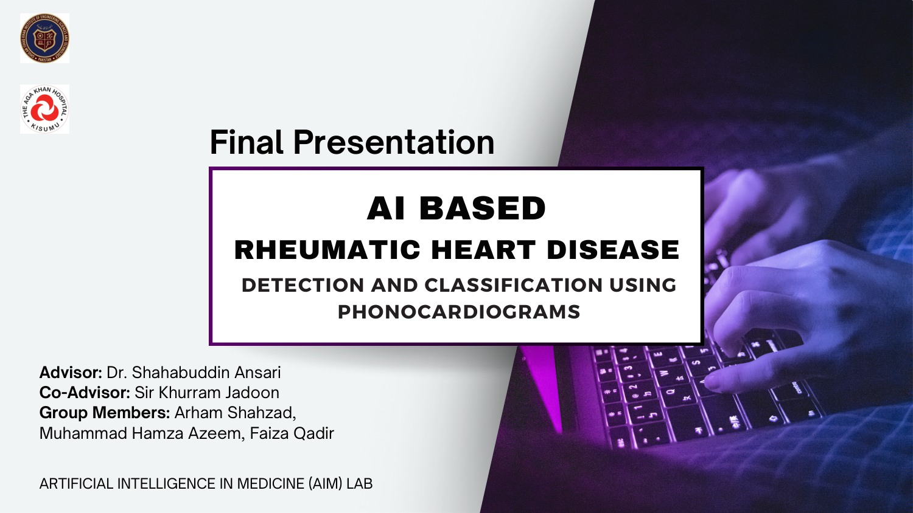
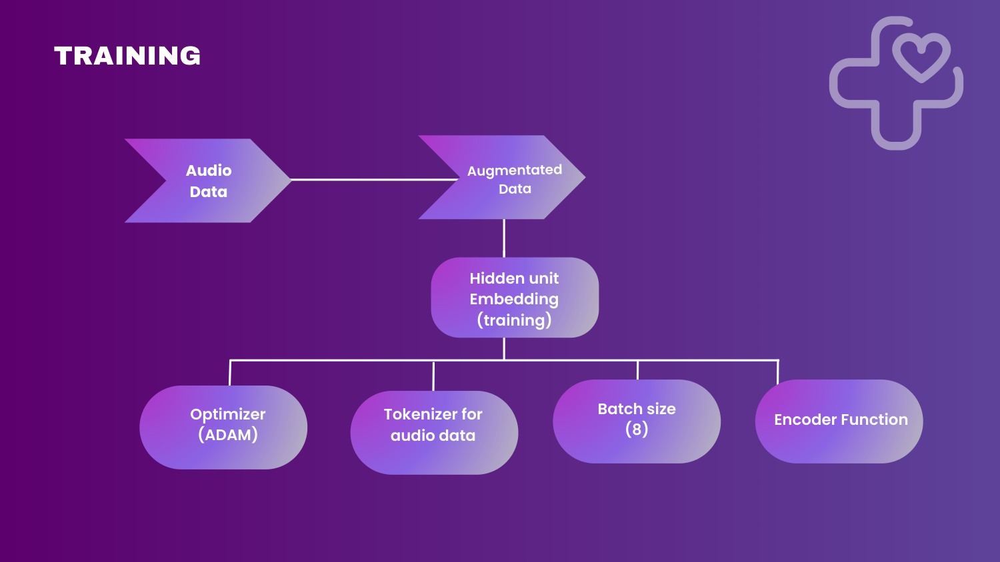
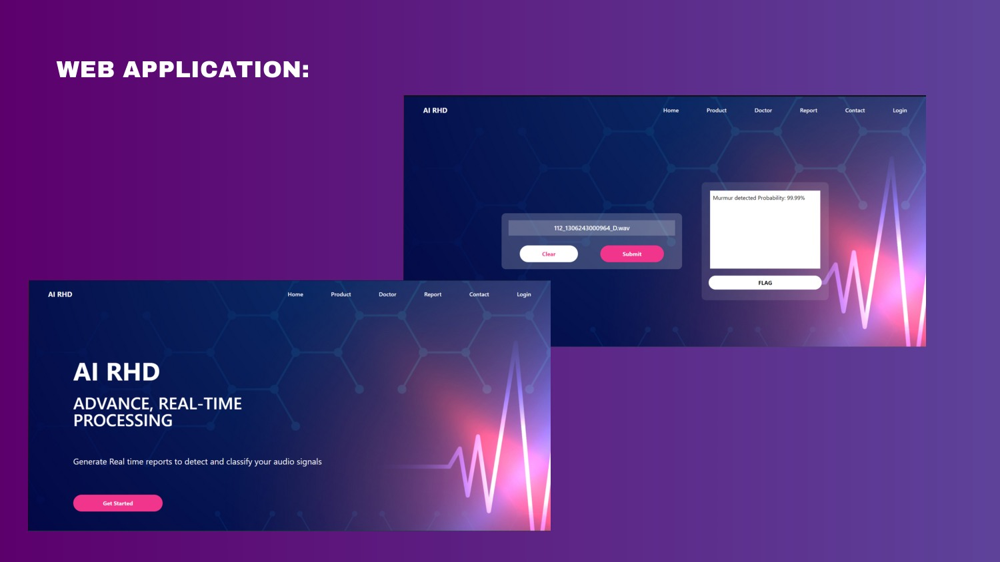
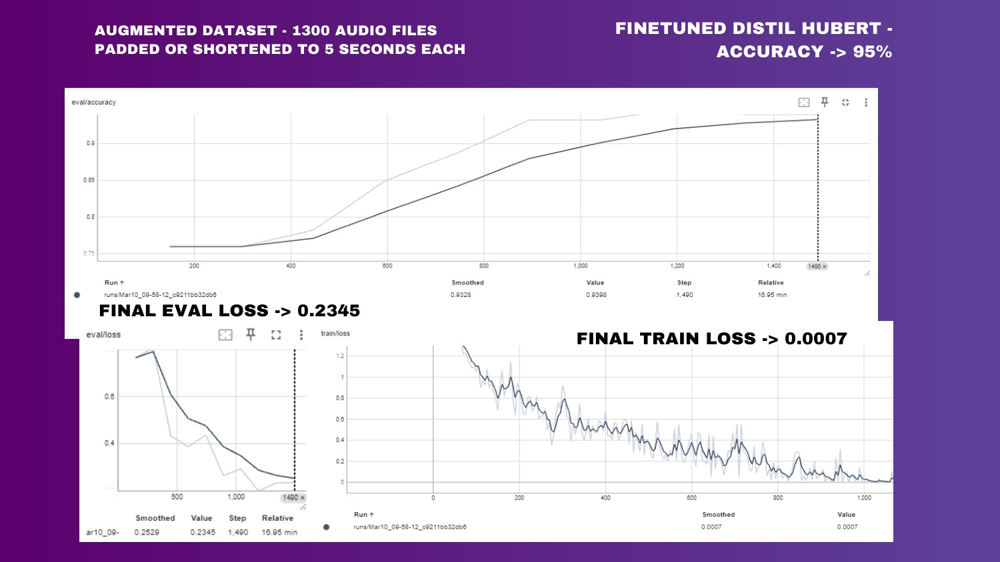
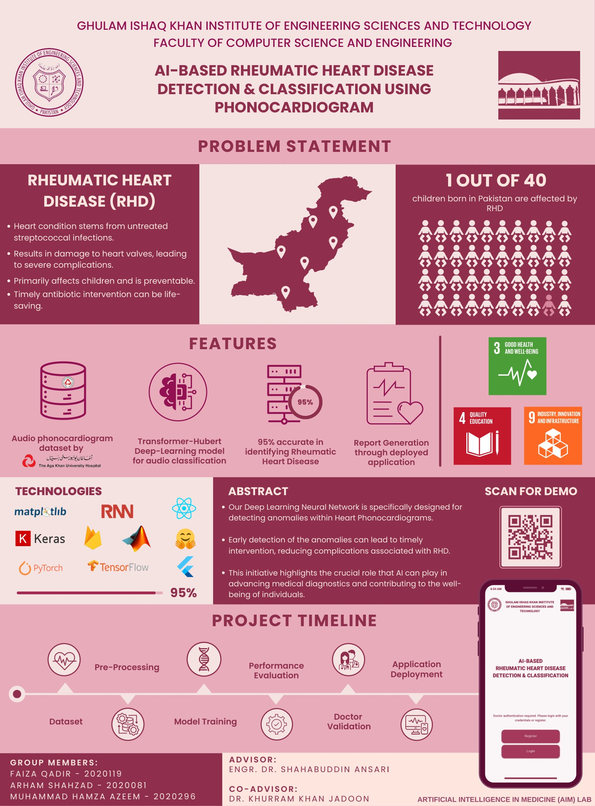

# AI-Based Rheumatic Heart Disease Detection and Classification

[Report](https://drive.google.com/file/d/1BrRuZqyo3YkyOsw_8qskbOPPVKCMnPXp/view) · [Demo video](https://drive.google.com/file/d/1nCyEOSsR4w2iWqOVlQEANKVqJ0ka9cX9/view) · [Notebook](thesis_original_sanitized.ipynb) · [Poster](project-poster.jpg)

For my bachelor's thesis at the Ghulam Ishaq Khan Institute of Engineering Sciences and Technology (GIKI), I worked with Faiza Qadir and Muhammad Hamza Azeem on classifying heart sounds from phonocardiogram (PCG) recordings.

We explored an LSTM baseline and a fine-tuned DistilHuBERT audio transformer, along with audio preprocessing, augmentation, and an application prototype. My main responsibility was developing the HuBERT-based model.

## My contributions

I spent several months developing and fine-tuning the HuBERT-based classifier, running successive experiments and refining the model. My notebook includes filtering and normalization experiments, audio export, DistilHuBERT fine-tuning with Hugging Face Transformers, and a Gradio classification demo.

This repository contains part of that experimentation. I no longer have a complete record of every experiment, so I focus here on the code and results I can document.

## Project materials

- [Final thesis report](https://drive.google.com/file/d/1BrRuZqyo3YkyOsw_8qskbOPPVKCMnPXp/view)
- [Project paper](https://drive.google.com/file/d/1rnty9tLLq5t2Q_ZO48VMdIaTzXbQmiQb/view)
- [Demo video](https://drive.google.com/file/d/1nCyEOSsR4w2iWqOVlQEANKVqJ0ka9cX9/view)
- [Project poster](https://drive.google.com/file/d/1_kmUAhUTQj2nlNTFeBOLc1lgz7v97g6Z/view)
- [Original Colab notebook](https://colab.research.google.com/drive/13v7VdgBpLNQ2y3cI8qOpEpgRWamKY-Od)

## Our approach

We investigated filtering, normalization, and acoustic features such as MFCCs, spectral centroids, and zero-crossing rate. We also explored augmentation using time shifts, time stretching, pitch shifts, and volume adjustments in MATLAB.

For classification, we compared an LSTM approach with fine-tuning of `ntu-spml/distilhubert`. I used Hugging Face Transformers for the HuBERT model and built a Gradio interface for trying audio classification.

I have included my preprocessing and transformer notebook here. This repository does not include the LSTM implementation or the MATLAB augmentation scripts.

*Our presentation’s overview of audio augmentation and model training.*

## Application prototype

We demonstrated the classification model as part of a wider application prototype. These screenshots show our web interface; my main contribution was developing the HuBERT classifier.

## Results and limitations

In our thesis, we reported the following accuracies:

| Approach | Reported accuracy |
| --- | ---: |
| LSTM | 66% |
| Fine-tuned DistilHuBERT | 95% |

*Our original presentation plots. The evaluation limitations below apply to these results.*

We expanded approximately 400 recordings to around 1,300 through augmentation. These figures come from our original thesis experiments; I have not rerun the training for this repository.

My notebook loads the combined original and augmented recordings, then randomly splits them into 90% training and 10% evaluation data (`seed=42`). This split does not explicitly keep each original recording and its augmented versions together, or group recordings by patient. Related recordings may therefore appear in both partitions, which could inflate the measured accuracy.

I also used the evaluation partition to select the best checkpoint. The notebook does not include a separate untouched test set. To evaluate generalization more reliably, I would split by original recording and patient before augmentation, then evaluate once on an untouched test set.

We developed this as an academic research prototype. Our heart-sound classification results do not establish clinical RHD diagnostic performance.

## Project poster

View our full project poster

Our poster presents the project as we described it at the time. For the scope of the reported accuracy, see the evaluation limitations above.

## Code and setup

- [`thesis_original_sanitized.ipynb`](thesis_original_sanitized.ipynb) — my original Colab notebook, with credentials and saved outputs removed.
- [`REPRODUCIBILITY.md`](REPRODUCIBILITY.md) — environment assumptions, known code issues, and notes for revisiting the experiments.

The notebook uses paths from my Google Drive. You will need to update those paths and supply the corresponding labeled audio data. I have not included the dataset or trained weights in this repository.

The notebook references `arham061/distilhubert-finetuned-PASCAL_Dataset_Augmented` on Hugging Face. I have not checked its current availability. The report, poster, and demo links point to Google Drive and may require access permissions.

## Team and supervision

- Arham Shahzad
- Faiza Qadir
- Muhammad Hamza Azeem

Our advisor was Dr. Shahab Uddin Ansari, and our co-advisor was Dr. Khurram Jadoon. We also consulted and collaborated with Aga Khan Hospital, as described in our thesis.

## License

I have not added a license to this repository. The project documents include team work and third-party figures, so I need to clarify the applicable rights before assigning a license.
